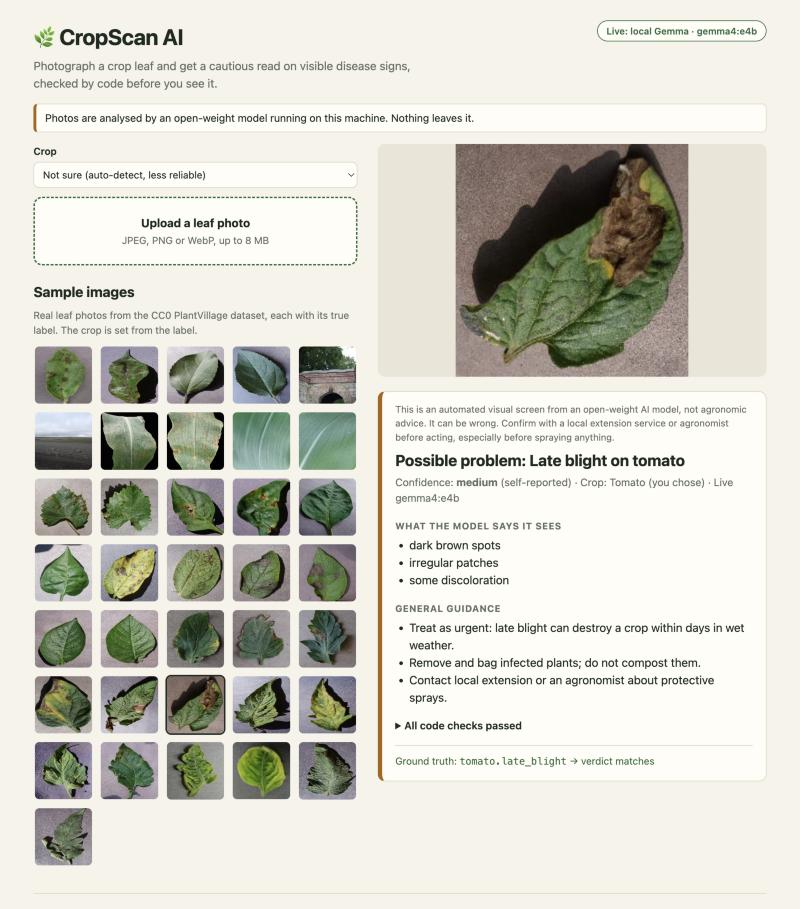

# CropScan AI

Photograph a crop leaf and get a cautious, checked read on visible disease signs. It runs an open-weight
**Gemma 4** vision model locally through [Ollama](https://ollama.com), so there are no cloud keys, no accounts and
no image leaves your machine.



> **Not agronomic advice.** This is an automated visual screen from a small AI model. It can be wrong, and
> the eval below shows exactly how often. Confirm with a local extension service or agronomist before acting,
> especially before spraying anything.

Originally a 2025 hackathon prototype on Google Cloud Vertex AI. Reworked in October 2026 as a complete open-source app.

## Run it locally

You need [Node 20+](https://nodejs.org) and [Ollama](https://ollama.com/download).

```bash
ollama pull gemma4:e4b
git clone https://github.com/MuhammadMurtuzaHussain/CropScan-AI.git
cd CropScan-AI
npm install && npm start
```

Open http://localhost:3001. Pick the crop, then upload a photo or click a sample image.
`gemma4:e4b` is about 6.6 GB; to try another Ollama vision model set `OLLAMA_MODEL`
(other variables: `OLLAMA_HOST`, `PORT`). Only `gemma4:e4b` has been measured.

Development with hot reload: `npm run dev` (API on :3001, Vite on :5173).

## How it stays honest

A model's answer is treated as untrusted input. Between the model and the screen sits code you can read and test:

1. **Structured output.** Ollama is given a JSON schema, so the model can only return fields from a fixed vocabulary
   (`server/src/schema.js`). It describes what it sees before it names a condition.
2. **You pick the crop.** Recognising the crop from a lone leaf is the weakest step for this model (see below),
   so the app asks. With a crop chosen, the model only chooses among that crop's known conditions.
3. **Code-side validation** (`server/src/validate.js`). The answer must parse, stay inside the allowed list, name a
   condition that belongs to the crop, stick to the crop you chose, and cite signs that fit what it claimed.
   A "healthy" call that cites spots, or a disease with no matching evidence, is downgraded to "can't tell".
   Every check is shown in the result.
4. **Advice never comes from the model.** Guidance is looked up per disease from `server/src/knowledge.js`
   (general, non-prescriptive: sanitation, airflow, "ask an advisor about sprays"). The model can't invent a dosage.
5. **Confidence is labelled for what it is.** It is the model's self-rating, adjusted down by the checks, and is
   never shown as a probability. A suspected disease is never shown as "high".
6. **A permanent not-agronomic-advice note** on every result.

## What the eval measured

`npm run eval` runs 36 labelled PlantVillage photos (2 per class, 17 leaf classes plus background-only; CC0)
through the real model and writes [EVAL.md](EVAL.md). Model `gemma4:e4b`, 2026-10-26, temperature 0, one run.
The first run on these images exposed a design flaw (the model never named the crop); the crop-selector design was then tuned on 18 other PlantVillage images taken from nearby rows, which may show the same leaves. So this is not a clean hold-out and the numbers are optimistic.

With the crop supplied (the default way to use the app), on 34 leaf images:

| | Raw model | After code checks |
|---|---|---|
| Healthy vs problem, right | 94.1% (32/34) | 94.1% (32/34) |
| Healthy vs problem, flatly wrong | 2 | 1 |
| Abstained ("can't tell") | 0 | 1 |
| Named a specific disease | 3 | 3 |
| Named the right disease | 3 of 3 | 3 of 3 |

What this means, plainly:

- Gemma 4 e4b is good at **spotted versus clean** on these photos and all 10 healthy leaves were called healthy.
- It is **poor at naming the disease**: only 3 of 24 diseased leaves (12.5%) got the exact disease. When it
  does name one, the app shows it; otherwise it says "a problem not on the list" and shows the signs it saw.
- With **no crop supplied**, it named the correct crop on only 2 of 34 leaves (5.9%), and the checks then
  refused to name diseases, so the app asks you for the crop.
- The code checks changed the outcome on 1 of 34 images in the default mode. They are a safety net more than a
  boost, and the unit tests cover the cases they exist for.
- Two images per class is a smoke test, not a benchmark. PlantVillage photos are single leaves on plain
  backgrounds, so real field photos will do worse. Larger models may do better; that is untested here.

## Free hosted demo

`npm run build` produces a static site in `web/dist` that needs no server and no model. If it can't reach
the API it switches to a **recorded** mode: the sample images replay the real Gemma outputs saved by the eval
(re-validated by the same code at build time), clearly labelled "Recorded run", with uploads disabled.
A repo workflow, `.github/workflows/pages.yml`, publishes it to GitHub Pages.
The running Node server falls back the same way when Ollama isn't reachable.

## Layout

```
server/src/   knowledge.js (conditions + advice)  schema.js  validate.js  ollama.js  app.js
server/eval/  run.js (eval)  metrics.js  results.json (saved model outputs)
server/test/  node:test unit + API tests (model mocked)
web/          Vite + React UI, scripts/build-demo.js (static recorded demo)
samples/      36 labelled CC0 images + manifest.json
```

`npm test` runs the server and web tests (no model needed).

## Limits

Supported crops: apple, corn, grape, bell pepper, potato, tomato; 12 diseases in total (see `knowledge.js`).
Anything else gets a "can't tell" or, for healthy-looking leaves, a hedged healthy call. It sees one image at a
time and knows nothing about weather, soil or region.

## Credits and licence

Code: MIT. Sample images: [PlantVillage](https://huggingface.co/datasets/DScomp380/plant_village), CC0 1.0.
Model: Google's Gemma 4, used under its own licence via Ollama.
